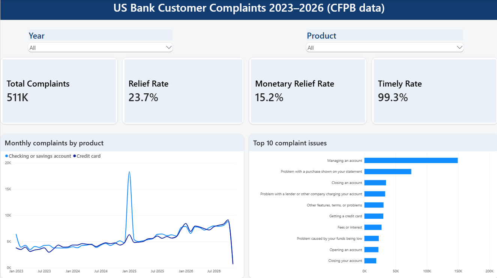
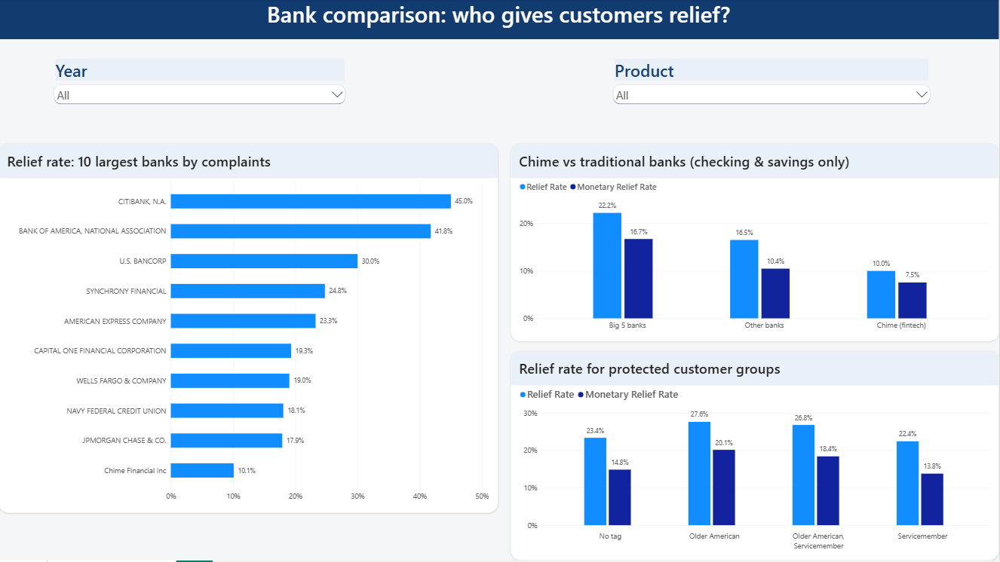

# US Bank Customer Complaints Analysis (CFPB, 2023–2026)

**Where are bank customers struggling, and which banks actually resolve their complaints?**

An end-to-end analysis of **511,395 consumer complaints** about checking/savings accounts and credit cards, filed with the US Consumer Financial Protection Bureau (CFPB) between January 2023 and November 2026.

**Tools:** Python (pandas) · SQL (SQLite) · Power BI (DAX)



---

## Business questions

1. How has complaint volume changed over time?
2. What are customers complaining about most, by product?
3. Which banks get the most complaints, and how often do they give relief?
4. Which issues most often lead to customers getting money back?
5. Are older Americans and servicemembers treated differently?
6. How does a fintech (Chime) compare with traditional banks?

---

## Key findings

**1. Bank complaints are increasing significantly.**
Consumer complaints increased by approximately 63% between 2023 and 2025. Based on the current trend, complaints in 2026 could reach around 182,000, which would be approximately 19% higher than 2025. Credit card complaints in 2026 have already exceeded the total recorded for the entire previous year, indicating growing customer concerns around credit card services.

**2. A third-party outage caused a major spike in complaints.**
Checking and savings account complaints rose sharply to 18,334 in January 2025, compared with the usual monthly volume of around 5,000. Most of these complaints were associated with Navy Federal and Capital One during January 15–18. The Capital One complaints coincided with an FIS-related service disruption that affected customers' access to deposits. This highlights how failures involving external technology providers can create significant customer impact and operational risk for financial institutions.

**3. Account management issues are the biggest source of checking account complaints.**
More than half of checking and savings complaints (56.5%) relate to account management. Within this category, deposit and withdrawal problems account for approximately 36%, while debit card and ATM-related issues make up around 23%. Credit card complaints have a different pattern, with billing disputes involving purchases shown on statements representing the largest share at approximately 30%.

**4. Banks have very different complaint relief rates.**
Citibank and Bank of America provide relief in 45.0% and 41.8% of closed complaints, respectively, compared with only 17.9% at JPMorgan Chase, 19.3% at Capital One, and 19.0% at Wells Fargo. A comparison of credit card complaint shares also suggests that differences in complaint mix alone do not explain these gaps. This indicates that complaint resolution outcomes may vary considerably across banks and deserve further investigation.

**5. Credit card fee and billing complaints are more likely to result in monetary relief.**
Among credit card complaints, issues related to fees or interest result in monetary relief in approximately 32.9% of cases, followed by purchase-related billing disputes at 27.8%. In contrast, account management complaints have the highest volume but a much lower monetary relief rate of 13.0%. This suggests that complaint volume and the likelihood of receiving money back are not necessarily related.

**6. Relief outcomes differ between older Americans and servicemembers.**
Older Americans receive higher relief rates than the baseline across both checking/savings and credit card complaints. Their relief rates are 20.5% compared with 18.5% for checking/savings, and 33.7% compared with 28.7% for credit cards. Servicemembers, however, have slightly lower relief rates than the baseline in both categories (17.5% vs 18.5% for checking/savings and 28.1% vs 28.7% for credit cards). Although the difference is small, it is consistent across products and worth monitoring to ensure complaints are handled fairly.

**7. Chime responds quickly but provides less relief.**
For checking and savings complaints, Chime has a relief rate of approximately 10.0%, compared with 22.2% for the Big 5 banks. Despite this, Chime responds to nearly all complaints on time, with a timely rate of approximately 99.99%. Unauthorized transactions and debit card issues account for around 37% of its complaints. Since unauthorized electronic transactions are covered by consumer protections under Regulation E, these complaint patterns deserve closer review. However, the complaint data alone cannot determine whether individual claims were valid or whether regulations were violated.



---

## Recommendations

- **Banks with low relief rates** (JPMorgan Chase, Capital One, Wells Fargo) should review whether complaints closed without relief are being resolved fairly, using Citibank and Bank of America as benchmarks.
- **Prioritise deposit/withdrawal handling and debit card issues**, which drive most checking complaints.
- **Review fee and billing practices** on credit cards, the issues most likely to end in refunds.
- **Manage third-party risk:** the January 2025 outage shows how one vendor failure can trigger a wave of complaints.
- **Compliance teams** should keep monitoring outcomes for servicemembers, and fintechs like Chime should review how unauthorized-transaction claims are resolved.

---

## Data

- **Source:** [CFPB Consumer Complaint Database](https://www.consumerfinance.gov/data-research/consumer-complaints/) (public domain)
- **Scope:** Checking or savings accounts and credit cards, complaints received 1 Jan 2023 – 14 Nov 2026
- **Download:** the website limits filtered exports to 100,000 rows, so the data was downloaded in 9 slices (by product and year) and combined in Python. Row counts were checked against the website totals.
- **Note:** in August 2026 the CFPB stopped publishing complaint narratives (the consumer's own text), so this analysis uses the structured fields only.

## Data cleaning

| Step | Rows |
|---|---|
| Combined 9 downloaded slices | 571,791 |
| Removed prepaid/gift cards (old 2023 "Credit card or prepaid card" label) | 569,138 |
| Removed complaints against credit bureaus (Equifax, TransUnion, Experian), which are not banks | 511,401 |
| Removed 6 rows with missing or invalid categories | **511,395** |

### Data quality summary

| Data Quality Check | Observation | Action Taken |
|---|---|---|
| Data consolidation | Data was downloaded in 9 separate files based on product and year. | Combined all files into one dataset for analysis. |
| Product consistency | The dataset included an older product category, "Credit card or prepaid card," which also contained prepaid and gift card complaints. | Removed prepaid/gift card records to keep the analysis focused on credit cards and checking/savings accounts. |
| Company relevance | Complaints against Equifax, TransUnion, and Experian were included, but these are credit reporting agencies rather than banks. | Excluded complaints against credit bureaus from the bank-focused analysis. |
| Missing or invalid categories | Some records had missing or invalid category values. | Removed 6 records that could not be reliably classified. |
| Date validity | Checked whether any complaint was sent to a company before it was received. None were found. | Dates were treated as reliable and kept as they are. |
| Complaint status | Some complaints were still marked as "In progress" and did not have a final outcome. | Included them in complaint volume analysis but excluded them from relief rate calculations. |
| Blank text fields | Most complaints have no tag or public company response. Filling them with the word "None" caused pandas to read them back as missing values. | Filled them with "No tag" and "No public response" instead. |
| State information | Some state values were blank, and some records represented military or territory locations. | Replaced blank state values with "Unknown" and grouped military and territory codes together. |
| Geographic data | ZIP codes were partially masked by the CFPB for privacy reasons. | Did not use ZIP codes in the analysis. |
| KPI preparation | Outcome fields were not directly available in the format required for analysis. | Created flags for closed complaints, relief received, monetary relief received, and timely responses. |

## Metrics

| Metric | Definition | Value |
|---|---|---|
| Total complaints | All complaints in scope | 511,395 |
| Relief rate | Closed complaints with monetary or non-monetary relief ÷ closed complaints | 23.7% |
| Monetary relief rate | Closed complaints with money returned ÷ closed complaints | 15.2% |
| Timely rate | Complaints answered on time ÷ all complaints | 99.3% |

## Limitations

- **Not adjusted for bank size.** Larger banks have more customers, so more complaints doesn't automatically mean worse service.
- **Complaints are unverified.** They are consumers' claims, not proven findings.
- **Not a representative sample** of all customers. Complaint volume also depends on awareness of the CFPB.
- **November 2026 is a partial month** (data to 14 November), which explains the drop at the end of the trend chart.

---

## Repository structure

```
bank-complaints-analysis/
├── notebooks/
│   ├── 01_load_and_combine.ipynb   # combine the 9 downloaded slices
│   ├── 02_data_quality.ipynb       # data quality checks and decisions
│   ├── 03_clean.ipynb              # apply cleaning, add outcome flags
│   ├── 04_load_sqlite.ipynb        # load clean data into SQLite
│   └── 05_sql_analysis.ipynb       # 6 business questions in SQL, with insights
├── dashboard/
│   └── bank_complaints_dashboard.pbix
├── images/                         # dashboard screenshots
└── data/                           # not in Git (files too large)
    ├── raw/
    └── processed/
```

## How to reproduce

1. Download the CFPB slices (Checking or savings account / Credit card, by year from 2023; plus "Credit card or prepaid card" for 1 Jan – 16 Aug 2023) into `data/raw/`
2. Run notebooks `01` to `05` in order
3. Open `dashboard/bank_complaints_dashboard.pbix` in Power BI Desktop and refresh the data source path if needed
